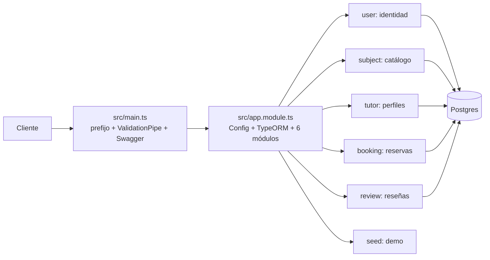
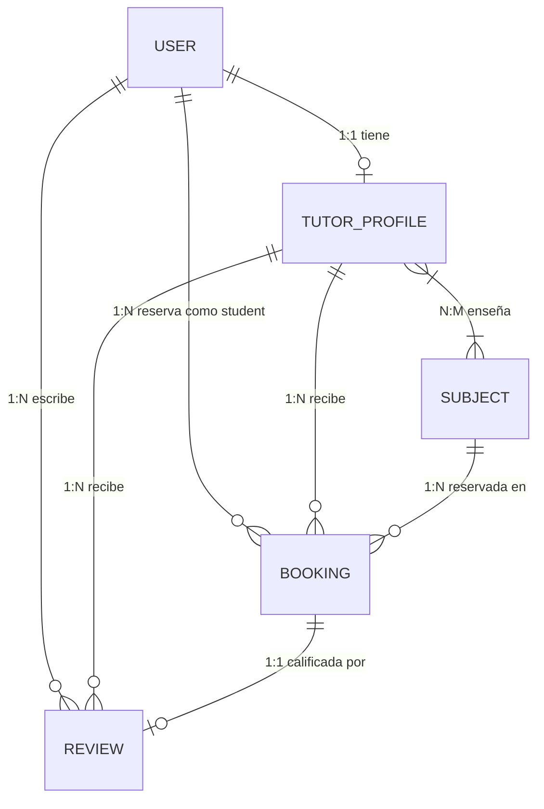

# TutorLink

Backend del taller de Computación en Internet III (NestJS + PostgreSQL). TutorLink es un marketplace de tutorías universitarias: un estudiante busca un tutor por materia, universidad y tarifa, reserva una sesión y, si quiere, deja una reseña cuando la sesión terminó.

**Equipo:** Miguel Pérez, Johan Suarez, Juan Sebastián Rodríguez Legarda
**Entrega del taller:** 13 de octubre de 2026

La API escucha en el puerto **9000** con el prefijo global `tutorlink`. En local, Swagger está en **`http://localhost:9000/docs`**.

La aplicación desplegada está en Render:

- API: `https://compu3-tallernest-tutorlink.onrender.com/tutorlink`
- Swagger: `https://compu3-tallernest-tutorlink.onrender.com/docs`

Si el servicio estuvo un rato sin tráfico, la primera petición puede tardar mientras Render lo despierta. Un usuario nuevo entra siempre como `student`. Los roles son `student`, `tutor` y `admin`.

El informe del taller está en [`docs/Informe-TutorLink.docx`](docs/Informe-TutorLink.docx). Este README es la documentación técnica completa y la guía de sustentación.

## Tabla de contenidos

- [1. Presentación](#1-presentación)
- [2. Tecnologías](#2-tecnologías)
- [3. Arquitectura y estructura](#3-arquitectura-y-estructura)
- [4. Instalación y configuración](#4-instalación-y-configuración)
- [5. Funcionamiento general](#5-funcionamiento-general)
- [6. Lógica de negocio y reglas](#6-lógica-de-negocio-y-reglas)
- [7. Módulos y componentes](#7-módulos-y-componentes)
- [8. API REST y endpoints](#8-api-rest-y-endpoints)
- [9. Modelo de datos y persistencia](#9-modelo-de-datos-y-persistencia)
- [10. Seguridad y validaciones](#10-seguridad-y-validaciones)
- [11. Manejo de errores](#11-manejo-de-errores)
- [12. Pruebas](#12-pruebas)
- [13. Despliegue](#13-despliegue)
- [14. Guía de sustentación](#14-guía-de-sustentación)
- [15. Limitaciones y mejoras futuras](#15-limitaciones-y-mejoras-futuras)
- [16. Referencias](#16-referencias)

## 1. Presentación

### Descripción ejecutiva

TutorLink conecta estudiantes que necesitan refuerzo académico con tutores universitarios que ofrecen sesiones pagadas por horas. El flujo central es: buscar tutor con filtros → reservar una franja horaria → el tutor confirma → se dicta la sesión → el tutor la marca completada → el estudiante deja una reseña.

### Problema que resuelve

Coordinar tutorías por chat o planillas genera choques de horario, materias mal asignadas y reseñas sin verificación. TutorLink centraliza el catálogo de materias, valida que el tutor dicte la materia, bloquea solapamientos de horario y solo permite reseñar sesiones completadas propias.

### Objetivo general

Proveer una API REST autenticada con roles que gestione usuarios, materias, perfiles de tutor, reservas con máquina de estados y reseñas con promedio, con persistencia en PostgreSQL y cobertura de pruebas superior al 80 %.

### Actores

| Actor | Qué hace |
|---|---|
| `student` (por defecto) | Busca tutores/materias, reserva, cancela sus reservas, reseña sus sesiones completadas |
| `tutor` (otorgado por admin) | Crea/reemplaza su perfil (`PUT /tutor/me`), confirma y completa sus reservas |
| `admin` (creado por seed) | Gestiona usuarios y roles, cura el catálogo de materias, verifica tutores |

### Funcionalidades principales

- Registro, login, logout con revocación de JWT, perfil propio, listado admin, cambio de roles, desactivación lógica.
- Catálogo de materias con unicidad compuesta y búsqueda insensible a mayúsculas.
- Perfiles de tutor con tarifa, universidad, materias y verificación admin, más filtros de marketplace.
- Reservas con estados `PENDING → CONFIRMED → COMPLETED` y `CANCELLED`, validación de fechas futuras, tutor activo, materia dictada y sin solape activo.
- Reseñas 1–5 solo sobre reservas `COMPLETED` propias, una por reserva, con promedio calculado en SQL.
- Seed destructivo protegido por clave para demo, Swagger con JWT, colección Postman y CI con unitarias + e2e + despliegue.

### Alcance y limitaciones conocidas

- No hay pagos, notificaciones, chat ni disponibilidad recurrente: solo reservas puntuales con `startAt/endAt`.
- No hay refresh tokens ni blacklist en Redis: la revocación es por `tokenVersion`.
- La unicidad 1:1 reseña–reserva se refuerza en el service, sin constraint único en DB (ver sección 15).
- No existe carpeta `src/migrations/` aunque `data-source.ts` y `app.module.ts` tienen configuración para migraciones.
- `UpdateTutorProfile` y `UpdateBooking` existen como DTOs pero ningún controller los usa (decisión intencional, ver sección 6).

## 2. Tecnologías

| Tecnología | Versión verificada | Función en este proyecto |
|---|---|---|
| Node.js | 22 (Docker `node:22-slim`, CI `setup-node 22`) | Runtime. El `Dockerfile` compila con `npm run build` y ejecuta `node dist/main.js`. |
| NestJS (`@nestjs/*` v12) + `@nestjs/swagger` v12 | `package.json` | Framework modular: `Module/Controller/Service`, inyección de dependencias, guards, pipes, decoradores y Swagger. Toda la API está organizada en 6 módulos de dominio. |
| TypeScript (~6.0, `overrides` fija una sola copia) | `package.json` + `overrides` | Tipado de DTOs, entidades y `JwtPayload`. Sin el `overrides`, `npm ci` falla por copias duplicadas (documentado en la instalación). |
| TypeORM (+ `pg` 8, Postgres 14.3 en Docker y CI) | `typeorm`, `postgres:14.3` | Persistencia: entidades, repositorios inyectados con `@InjectRepository`, `QueryBuilder` para filtros dinámicos, `timestamptz`, enums nativos y arrays. |
| `class-validator` + `class-transformer` + `ValidationPipe` global | `main.ts:9-16` | Validación de entrada: DTOs con `@IsString/@IsUUID/@Min/@Max/@IsEnum`, `whitelist+forbidNonWhitelisted` y `transform+enableImplicitConversion` para query strings. |
| Passport + `passport-jwt` + `@nestjs/jwt` | `user.module.ts`, `jwt.strategy.ts` | Autenticación: `PassportModule(defaultStrategy:'jwt')`, `JwtModule.registerAsync` con `JWT_SECRET` y expiración `1h`, estrategia que valida contra DB. |
| `bcrypt` 6 | `user.service.ts:82` | Hash de contraseñas con 10 salt rounds (`hashSync`) y comparación en login (`compareSync`). |
| Vitest 4 + `@vitest/coverage-v8` + Supertest | `vitest.config.ts`, `vitest.config.e2e.ts` | 92 unitarias (sin DB) y 4 archivos e2e (con Postgres). Umbral de cobertura 80 % en líneas/funciones/branches/statements. |
| `oxlint`, `prettier` | `npm run lint`, `.prettierrc` | Análisis estático (`oxlint src/ test/`) y formato. El CI falla si el lint falla. |
| Docker + docker-compose | `Dockerfile`, `docker-compose.yml` | `db` (Postgres 14.3 + volumen `pgdata` + healthcheck) y `api` (build multi-etapa, `DB_HOST=db` dentro de la red). |
| GitHub Actions, Render | `.github/workflows/tests.yml` | Jobs `unit` (build+lint+cov), `e2e` (Postgres de servicio), `deploy` (hook de Render solo en push a `main` si ambos pasan). |
| Postman, Swagger UI | `postman/TutorLink.postman_collection.json`, `main.ts:19-39` | Colección con variables `baseUrl`/`token`/`seedKey` y carpeta de escenarios con rechazos. Swagger en `/docs` con esquema `JWT-auth`. |

## 3. Arquitectura y estructura

Arquitectura modular por dominio sobre el contenedor IoC de NestJS. `AppModule` es delgado: solo configura (`ConfigModule` global + `TypeOrmModule.forRoot`) y registra los 6 módulos. Cada módulo expone su controller, encapsula su service y declara sus repositorios con `TypeOrmModule.forFeature`. `UserModule` es el módulo de identidad central: todos los demás lo importan para reusar `AuthGuard`, `UserRoleGuard`, `JwtStrategy` y `UserService` sin reconfigurar JWT.

Separación de responsabilidades:

- **Controller:** declara rutas, aplica `@Auth()`, extrae `@Body/@Param/@Query/@GetUser()` y delega. No tiene lógica de negocio.
- **Service (`@Injectable`):** implementa reglas, usa repositorios inyectados y lanza excepciones HTTP (`BadRequest/Unauthorized/Forbidden/NotFound/Conflict`).
- **DTO:** contrato de entrada con `class-validator`; de salida solo con `@ApiProperty`.
- **Entity:** mapeo TypeORM + restricciones DB + hooks (`@BeforeInsert/@BeforeUpdate`).
- **Guard/Strategy/Decorator:** seguridad transversal reutilizable.



Dependencias importantes: `Subject/Tutor/Booking/Review/Seed → UserModule` (auth); `Tutor → Subject` (valida `subjectIds`); `Booking → TutorProfile + Subject`; `Review → Booking`; `Seed → UserService.encryptPassword`.

Árbol simplificado (sin `node_modules`, `dist`, `.git`):

```text
src/
├── main.ts                  # bootstrap: prefijo, ValidationPipe, CORS, Swagger, listen 9000
├── app.module.ts            # Config + TypeORM + 6 módulos
├── data-source.ts           # DataSource solo para CLI TypeORM (migrations)
├── common/dto/pagination.dto.ts  # base limit/skip
├── user/                    # identidad: controller, service, entity, enums, dtos, guards, strategies, decorators
├── subject/                 # catálogo: controller, service, entity Unique(name,university,semester), dtos
├── tutor/                   # perfiles: controller (PUT me), service (upsert), entity OneToOne User + M2M Subject
├── booking/                 # reservas: controller (confirm/cancel/complete), service (máquina de estados), entity timestamptz
├── review/                  # reseñas: controller, service (solo COMPLETED propia, AVG SQL), entity OneToOne Booking
└── seed/                    # demo: controller (?key=), service (deleteAll + runSeed), data/seed.data.ts
test/                        # 4 e2e-spec (app, user-subject, tutor-booking, marketplace-rules)
postman/TutorLink.postman_collection.json
docs/Informe-TutorLink.docx
.github/workflows/tests.yml
docker-compose.yml Dockerfile
vitest.config.ts vitest.config.e2e.ts
```

## 4. Instalación y configuración

Prerrequisitos verificados: Node.js 22, Docker con compose, Git. La colección Postman ya apunta a Render, pero el desarrollo local usa lo siguiente.

1. Clonar e instalar:

```bash
git clone <repo> && cd Compu3-TallerNest_TutorLink
npm install
```

2. Variables de entorno. Crear `.env` en la raíz (está en `.gitignore`, no se sube a git). Todas son deducibles de `app.module.ts`, `user.module.ts`, `jwt.strategy.ts`, `seed.service.ts` y `docker-compose.yml`:

```env
DB_HOST=localhost
DB_PORT=5432
DB_NAME=tutorlink
DB_USERNAME=postgres
DB_PASSWORD=tu_password
DB_SYNCHRONIZE=true
DB_MIGRATIONS_RUN=false
JWT_SECRET=un_secreto_largo
JWT_EXPIRES_IN=1h
ADMIN_EMAIL=admin@tutorlink.com
ADMIN_PASSWORD=tu_password_admin
ADMIN_FULL_NAME=Administrador TutorLink
SEED_KEY=una_clave_para_el_seed
```

Notas: `DB_SYNCHRONIZE=true` crea/altera tablas al arrancar (solo desarrollo, jamás en producción). `DB_MIGRATIONS_RUN` y `migrations` están configurados pero no hay archivos en `src/migrations/` (pendiente de verificar si el taller exige migraciones reales). `JWT_SECRET` es obligatorio: sin él la app lanza `Error` al arrancar (fail-fast en `user.module.ts` y `jwt.strategy.ts`).

3. Base de datos y API:

```bash
docker compose up -d db
npm run start:dev
```

La API queda en `http://localhost:9000/tutorlink`, Swagger en `http://localhost:9000/docs`. `docker compose up -d` (sin `db`) también levanta la API en Docker (usa `DB_HOST=db` dentro de la red). PostgreSQL aplica `DB_PASSWORD` solo la primera vez que crea el volumen `pgdata`; si cambió el `.env` después, hay que recrear el volumen.

4. Datos iniciales (solo local, con la API arriba):

```bash
curl "http://localhost:9000/tutorlink/seed?key=una_clave_para_el_seed"
```

Responde `{ "message": "SEED EXECUTED", "admin", "subjects", "students", "tutors" }` y borra/recarga todo.

5. Comandos disponibles (`package.json`):

| Comando | Qué hace |
|---|---|
| `npm run start:dev` | Nest en watch |
| `npm run build` / `npm start` | Compila a `dist/` / arranca compilado |
| `npm test` / `npm run test:cov` | Unitarias / unitarias con cobertura (umbral 80 %) |
| `npm run test:e2e` | Integración (requiere Postgres y `RUN_E2E=true`) |
| `npm run lint` | `oxlint src/ test/` |
| `npm run typeorm -- migration:* -d src/data-source.ts` | CLI de migraciones (sin archivos de migración presentes) |

## 5. Funcionamiento general

Secuencia real de una petición (ejemplo `POST /tutorlink/booking`):

1. Cliente envía HTTP con `Authorization: Bearer <JWT>` (salvo `signup/auth/seed`).
2. `src/main.ts`: `setGlobalPrefix('tutorlink')` enruta; `ValidationPipe` valida/transforma el body/query contra el DTO (`400` si falla, `forbidNonWhitelisted` rechaza campos extra).
3. `@Auth(...)` (`user/decorators/auth.decorator.ts`): `AuthGuard('jwt')` ejecuta `JwtStrategy.validate()` (firma + existencia + `isActive` + `tokenVersion`, sino `401`); luego `UserRoleGuard` revisa roles (sino `403`).
4. Controller extrae `@Body/@Param(ParseUUIDPipe)/@Query/@GetUser()` y llama al service.
5. Service ejecuta reglas, consulta `Repository`/`QueryBuilder` y muta entidades.
6. TypeORM persiste en Postgres (hooks `@BeforeInsert/@BeforeUpdate`, uniques, FKs con `CASCADE` donde aplica).
7. Nest serializa el retorno (entidad o DTO de salida) como JSON con el código del decorador Swagger (`201/200`, o la excepción `400/401/403/404/409/500`).

Arranque: `main.ts:bootstrap()` → `NestFactory.create(AppModule)` → `app.module.ts` conecta TypeORM (`autoLoadEntities:true`, `synchronize` por env) → se registran controllers/providers/guards/strategy → Swagger en `/docs` → `listen(9000)`.

## 6. Lógica de negocio y reglas

### 6.1 Usuarios y roles

- **Registro crea siempre estudiante.** `UserService.create()` fuerza `roles:[STUDENT]`, `tokenVersion:0`, hashea con `bcrypt.hashSync(p,10)`. El DTO `Register` ni declara `roles`, y el pipe global rechaza extras. Evita auto-asignación de privilegios. Archivos: `user/dto/register.dto.ts`, `user/user.service.ts:32-49`.
- **Email canónico.** `User.checkEmailBeforeChanges()` (`@BeforeInsert/@BeforeUpdate`) aplica `toLowerCase().trim()`; `login()` busca igual. Evita duplicados `Ana@x.com` vs `ana@x.com`. Error `23505` → `409`.
- **Login no filtra existencia.** `compareSync` genérico + `UnauthorizedException('Email or password incorrect')`, luego bloquea `!isActive`. `password` y `tokenVersion` tienen `select:false`: hay que pedirlos explícito.
- **Revocación sin Redis.** `logout()` y `deactivate()` hacen `increment(tokenVersion)`; `JwtStrategy` compara con el payload y responde `401` si difiere. `isActive=false` también da `401` inmediato aunque el JWT no haya expirado.
- **Anti-bloqueo admin.** `updateRoles()` impide quitarse el propio `ADMIN`; `deactivate()` impide auto-desactivarse (`400`). Hacen `findOne` primero (`404`) y devuelven entidad fresca. Borrado siempre lógico (`isActive=false`), nunca `DELETE` físico.

### 6.2 Materias (catálogo curado)

- **Unicidad compuesta.** `@Unique(['name','university','semester'])` en `subject.entity.ts` + `normalize()` con `trim()` en hooks. Permite repetir materia en otra universidad/semestre, prohíbe duplicada exacta (`409`). Regla a nivel DB, no solo validación.
- **Escritura admin, lectura autenticada.** `POST/PATCH/DELETE @Auth(ADMIN)`, `GET @Auth()`. `create()` con `create+save`; `update()` con `preload()` (corre hooks, `undefined` → `404`); `remove()` con `remove()` (respeta cascadas, a diferencia de `delete` directo; retorna `{...subject,id}` porque TypeORM vacía el objeto).
- **Filtros.** `FilterSubject extends PaginationDto` (`university/semester/search` opcionales). `findAll()` con `QueryBuilder`: `UPPER()=UPPER()` insensible a mayúsculas, `LIKE %search%` parcial, `orderBy name ASC`, `take/skip`.

### 6.3 Tutores (perfil separado del usuario)

- **Rol antes que perfil.** El admin otorga `tutor` con `PATCH /user/:id/roles`; recién entonces `PUT /tutor/me @Auth(TUTOR)` funciona. El perfil (`tutor_profile`) es `OneToOne(User, CASCADE, eager)` + `M2M(Subject, eager)` con puente `tutor_profile_subjects`. `isVerified` nace `false`.
- **Upsert por identidad.** `upsertMyProfile()` valida `subjectIds` primero (`findSubjectsOrFail` con `In(ids)`, `404` si falta alguna), busca perfil por `user.id`, crea o reemplaza todos los campos (semántica PUT total). No existe `PUT :id`: imposible editar perfiles ajenos por diseño. Garantiza 1 perfil por usuario sin constraint DB.
- **Marketplace.** `FilterTutor` (`subjectId UUID`, `university`, `maxRate @Type Number`, `verified @Transform` porque query llega string). `findAll()` con `leftJoinAndSelect` (el `QueryBuilder` no respeta `eager`) filtra por puente M2M, `UPPER(university)`, `hourlyRate<=maxRate`, `isVerified`, ordena `hourlyRate ASC` (baratos primero).
- **Verificación.** `verify() @Auth(ADMIN)` solo marca `true` (sin toggle). `UpdateTutorProfile (PartialType)` existe pero no se usa: el reemplazo total ya cubre el caso; queda como deuda para un futuro PATCH parcial.

### 6.4 Reservas (máquina de estados + anti-solape)

Estados (`booking-status.enum.ts`): `PENDING → CONFIRMED → COMPLETED`, `PENDING|CONFIRMED → CANCELLED`. Sin saltos ni retrocesos.

`create(student, dto)` en `booking.service.ts:35-94` valida en orden: fechas ISO válidas → `end>start` → `start>now` (todas `400`) → `Subject 404` → `TutorProfile(+user+subjects) 404` → tutor activo sino `400` → tutor dicta la materia (`some`, sino `400`) → sin solape activo (`tp.id=:id AND status IN (PENDING,CONFIRMED) AND startAt<:end AND endAt>:start`, sino `409`) → crea en `PENDING`. La condición de solape es la intersección clásica de intervalos (si una termina justo cuando otra empieza, no choca). `timestamptz` en la entidad guarda zona horaria. `CANCELLED/COMPLETED` liberan horario.

`confirm()` exige dueño-tutor (`assertTutorOwner` → `403`) + `PENDING` (sino `400`) + re-chequeo de solape contra `CONFIRMED` excluyendo `b.id!=:id` (`409`): cubre la carrera entre `create` y `confirm`. `cancel()` acepta estudiante-dueño O tutor-dueño (`assertParty`) + `PENDING|CONFIRMED`. `complete()` exige dueño-tutor + `CONFIRMED`. `findMine()` hace `where student.id=:id OR tutorUser.id=:id` (privacidad: no hay `findAll` global) + filtro `status` + `orderBy startAt ASC` + paginación. `UpdateBooking (PartialType)` existe pero no se usa a propósito: las transiciones son por endpoints dedicados para impedir edición arbitraria de fechas/estados.

### 6.5 Reseñas (solo clase dictada, propia y única)

`ReviewService.create()` en `review.service.ts:23-62`: booking existe (`404`) → dueño (`booking.student.id===student.id`, sino `403`) → `status===COMPLETED` (sino `400`; bloquea `PENDING/CONFIRMED/CANCELLED`) → no existe reseña para ese booking (sino `409`) → `create({rating, comment.trim(), booking, student, tutorProfile})+save()`. `rating @IsInt @Min(1) @Max(5)`, `comment @MinLength(3) @MaxLength(500)`. Atada a `booking` (`@OneToOne @JoinColumn`), no a tutor genérico: sin clase no hay reseña. `findByTutor()` corre en paralelo `find(createdAt DESC)` + `SELECT AVG(rating)` y devuelve `{average:Number(avg)||0, count, reviews}` (`AVG` llega string; `0` si sin reseñas).

### 6.6 Seed (demo idempotente)

`SeedController.run(@Query('key'))` sin `@Auth` pero con secreto compartido: si `SEED_KEY` no está configurado o no coincide → `401` (seguro por defecto). `SeedService.runSeed()`: `deleteAll()` con SQL crudo en orden FK `review→booking→tutor_profile_subjects→tutor_profile→subject→user` → valida `ADMIN_*` de env (`500` si faltan, no hardcodeado) → crea admin `ADMIN` con `userService.encryptPassword()` reusado → 4 materias (`seed.data.ts`) con `Map(name→entity)` → 2 students `STUDENT` → 2 tutores `TUTOR` con `isVerified:true` para demo inmediata. Retorna conteos. Destructivo: solo dev/demo; en producción debería ser solo admin y no `GET`.

## 7. Módulos y componentes

### `UserModule` (`src/user/`)

- `user.controller.ts`: `POST signup` (pública, `Register` → `AuthResponse` 201/400/409), `POST auth` (pública, `Login` → `AuthResponse` 201/400/401), `GET me` (`@Auth()`, retorna `request.user` sin query), `POST logout` (`@Auth()`), `GET /` (`@Auth(ADMIN)` + `PaginationDto`), `GET :id` (`@Auth(ADMIN)` + `ParseUUIDPipe`), `PATCH :id/roles` (`@Auth(ADMIN)`, body `UpdateRoles`), `DELETE :id` (`@Auth(ADMIN)`, desactiva).
- `user.service.ts`: `create/login/logout/encryptPassword/findAll/findOne/updateRoles/deactivate` + privados `authResponse/getJwtToken/handleException` (ver 6.1).
- DTOs: `Register` (`email @IsEmail`, `password @MinLength(8) @MaxLength(16)`), `Login` (igual), `AuthResponse` (salida con `token`), `UpdateRoles` (`@IsArray @ArrayNotEmpty @ArrayUnique @IsEnum(each)`).
- `entities/user.entity.ts`: `id` UUID, `email unique text`, `password select:false`, `fullName`, `isActive default true`, `tokenVersion default 0 select:false`, `roles text[] default [STUDENT]`, hook de email.
- Seguridad: `enums/user-role.enum.ts`, `interfaces/jwt.interface.ts {id,email,tokenVersion}`, `decorators/role-protected.decorator.ts` (solo `SetMetadata`), `decorators/auth.decorator.ts` (compone `RoleProtected + UseGuards(AuthGuard(), UserRoleGuard) + ApiBearerAuth`; orden crítico), `decorators/get-user.decorator.ts` (`createParamDecorator`), `strategies/jwt.strategy.ts` (lee `JWT_SECRET` fail-fast, `fromAuthHeaderAsBearerToken`, `validate` con 3 chequeos), `guards/user-role.guard.ts` (`getAllAndOverride`, OR de roles).
- `user.module.ts`: `TypeOrmModule.forFeature([User])`, `PassportModule(defaultStrategy:'jwt')`, `JwtModule.registerAsync` (lee `JWT_SECRET`, expira `JWT_EXPIRES_IN ?? '1h'`), exporta todo para los demás módulos. Ejemplo de DI: `@InjectRepository(User) repo` + `JwtService` en el service; `Reflector` en el guard; `ConfigService` en strategy y módulo.

### `SubjectModule` (`src/subject/`)

Controller con las 5 rutas del catálogo (ver tabla 8), service con `create/findAll/findOne/update(preload)/remove(handle 23505)`, DTOs `CreateSubject/UpdateSubject(PartialType)/FilterSubject(PaginationDto)`, entidad con unique compuesta + `normalize()`. Importa `UserModule`; exporta `TypeOrmModule, SubjectService` para `Tutor/Booking/Seed`.

### `TutorModule` (`src/tutor/`)

Controller: `PUT me @Auth(TUTOR)`, `GET / @Auth()`, `GET :id @Auth()`, `PATCH :id/verify @Auth(ADMIN)`. Service: `upsertMyProfile/findAll/findOne/verify/findSubjectsOrFail/handleException` (ver 6.3). DTOs: `CreateTutorProfile` (`bio/academicHistory @MinLength(10)`, `hourlyRate @IsInt @Min(1)`, `university @MinLength(2)`, `subjectIds @ArrayNotEmpty @ArrayUnique @IsUUID(each)`), `FilterTutor`, `UpdateTutorProfile` sin uso. Entidad `TutorProfile` con `OneToOne/M2M eager`. Importa `forFeature([TutorProfile, Subject]) + UserModule`.

### `BookingModule` (`src/booking/`)

Controller: `POST / @Auth(STUDENT)`, `GET mine @Auth()` (antes de `:id` para que `mine` no se lea como id), `PATCH :id/confirm @Auth(TUTOR)`, `PATCH :id/cancel @Auth()`, `PATCH :id/complete @Auth(TUTOR)`, todos con `ParseUUIDPipe`. Service con `create/findMine/confirm/cancel/complete/findOneOrFail/assertTutorOwner/assertParty/handleException` y constante `ACTIVE_STATUSES`. DTOs `CreateBooking (@IsUUID + @IsDateString)`, `FilterBooking`, `UpdateBooking` sin uso. Entidad con `ManyToOne(student CASCADE eager, tutorProfile CASCADE eager, subject eager)`, `timestamptz`, enum default `PENDING`.

### `ReviewModule` (`src/review/`)

Controller: `POST / @Auth(STUDENT)`, `GET tutor/:tutorId @Auth()`. Service: `create/findByTutor/handleException`. DTO `CreateReview`. Entidad `OneToOne(Booking CASCADE)+ManyToOne(student/tutorProfile CASCADE eager)+CreateDateColumn`. Importa `forFeature([Review, Booking]) + UserModule`.

### `SeedModule` (`src/seed/`)

Controller `GET /seed?key=` con `401` por clave, service con `runSeed/deleteAll`, datos fijos en `data/seed.data.ts` (4 materias ICESI, `ana/luis` students, `tutor1/tutor2` con materias y tarifas 15000/18000, todos `Secreta123`). No exporta nada.

## 8. API REST y endpoints

Prefijo global `/tutorlink`. Públicas: `POST /user/signup`, `POST /user/auth`, `GET /seed?key=` (con clave). Todo lo demás exige `Authorization: Bearer <JWT>`.

| Método | Ruta | Descripción | Body / Params | Permiso | Respuesta | Códigos |
|---|---|---|---|---|---|---|
| POST | `/tutorlink/user/signup` | Crea estudiante + JWT | `{email, password 8-16, fullName}` | Pública | `AuthResponse {id,email,fullName,isActive,roles,token}` | 201/400/409 |
| POST | `/tutorlink/user/auth` | Login + JWT | `{email, password}` | Pública | `AuthResponse` | 201/400/401 |
| GET | `/tutorlink/user/me` | Mi perfil | — | Auth | `User` | 200/401 |
| POST | `/tutorlink/user/logout` | Invalida JWT (`tokenVersion++`) | — | Auth | `{message}` | 200/401/404 |
| GET | `/tutorlink/user?limit&skip` | Lista | `PaginationDto` | ADMIN | `User[]` | 200/400/401/403 |
| GET | `/tutorlink/user/:id` | Ver usuario | `id` UUID | ADMIN | `User` | 200/400/401/403/404 |
| PATCH | `/tutorlink/user/:id/roles` | Cambia roles | `id` + `{roles:[...]}` | ADMIN | `User` | 200/400/401/403/404 |
| DELETE | `/tutorlink/user/:id` | Desactiva (lógico) | `id` UUID | ADMIN | `{message}` | 200/400/401/403/404 |
| POST | `/tutorlink/subject` | Crea materia | `{name, university, semester}` | ADMIN | `Subject` | 201/400/401/403/409 |
| GET | `/tutorlink/subject?university&semester&search&limit&skip` | Lista con filtros | query | Auth | `Subject[]` | 200/400/401 |
| GET | `/tutorlink/subject/:id` | Ver materia | `id` UUID | Auth | `Subject` | 200/400/401/404 |
| PATCH | `/tutorlink/subject/:id` | Edita parcial | `id` + parcial | ADMIN | `Subject` | 200/400/401/403/404/409 |
| DELETE | `/tutorlink/subject/:id` | Borra | `id` UUID | ADMIN | `Subject` | 200/400/401/403/404 |
| PUT | `/tutorlink/tutor/me` | Crea/reemplaza mi perfil | `{bio 10+, hourlyRate int≥1, academicHistory 10+, university, subjectIds UUID[]}` | TUTOR | `TutorProfile` | 200/400/401/403/404 |
| GET | `/tutorlink/tutor?subjectId&university&maxRate&verified&limit&skip` | Lista marketplace | query | Auth | `TutorProfile[]` | 200/400/401 |
| GET | `/tutorlink/tutor/:id` | Ver tutor | `id` UUID perfil | Auth | `TutorProfile` | 200/400/401/404 |
| PATCH | `/tutorlink/tutor/:id/verify` | Verifica | `id` UUID perfil | ADMIN | `TutorProfile` | 200/400/401/403/404 |
| POST | `/tutorlink/booking` | Crea reserva `PENDING` | `{tutorProfileId, subjectId, startAt ISO, endAt ISO}` | STUDENT | `Booking` | 201/400/401/403/404/409 |
| GET | `/tutorlink/booking/mine?status&limit&skip` | Mis reservas (ambas caras) | query | Auth | `Booking[]` | 200/400/401 |
| PATCH | `/tutorlink/booking/:id/confirm` | `PENDING→CONFIRMED` | `id` UUID | TUTOR dueño | `Booking` | 200/400/401/403/404/409 |
| PATCH | `/tutorlink/booking/:id/cancel` | `→CANCELLED` | `id` UUID | Parte dueña | `Booking` | 200/400/401/403/404 |
| PATCH | `/tutorlink/booking/:id/complete` | `CONFIRMED→COMPLETED` | `id` UUID | TUTOR dueño | `Booking` | 200/400/401/403/404 |
| POST | `/tutorlink/review` | Reseña | `{bookingId, rating 1-5, comment 3-500}` | STUDENT dueño | `Review` | 201/400/401/403/404/409 |
| GET | `/tutorlink/review/tutor/:tutorId` | Reseñas + promedio | `tutorId` UUID perfil | Auth | `{average, count, reviews}` | 200/400/401 |
| GET | `/tutorlink/seed?key=` | Borra y recarga demo | `key` query | Clave | `{message, admin, subjects, students, tutors}` | 200/401/500 |

Ejemplos realistas:

```bash
# Registro (201) o 409 si el email existe
curl -X POST http://localhost:9000/tutorlink/user/signup \
  -H "Content-Type: application/json" \
  -d '{ "email": "ana@example.com", "password": "Secreta123", "fullName": "Ana Pérez" }'
# → { "id": "uuid", "email": "ana@example.com", "fullName": "Ana Pérez",
#     "isActive": true, "roles": ["student"], "token": "eyJ..." }

# Reserva (201 PENDING) o 409 por solape / 400 si el tutor no dicta la materia
curl -X POST http://localhost:9000/tutorlink/booking \
  -H "Authorization: Bearer <token_estudiante>" -H "Content-Type: application/json" \
  -d '{ "tutorProfileId": "<uuid>", "subjectId": "<uuid>",
        "startAt": "2026-10-20T14:00:00.000Z", "endAt": "2026-10-20T15:00:00.000Z" }'

# Reseña (201) o 400 si no está COMPLETED / 403 si no es propia / 409 si duplicada
curl -X POST http://localhost:9000/tutorlink/review \
  -H "Authorization: Bearer <token_estudiante>" -H "Content-Type: application/json" \
  -d '{ "bookingId": "<uuid>", "rating": 5, "comment": "Explica muy claro y es puntual." }'
# GET promedio → { "average": 5, "count": 1, "reviews": [...] }
```

Paginación: `limit` (`@IsPositive`) y `skip` (`@Min(0)`) con defaults `10/0` en cada service, traducidos a `take/skip`. Filtros siempre opcionales y con `trim()`/`UPPER` donde aplica. Errores: `400` validación/regla, `401` sin token o revocado, `403` sin rol o no dueño, `404` inexistente, `409` conflicto (duplicado/solape/reseña duplicada).

La colección `postman/TutorLink.postman_collection.json` cubre estos endpoints con variables `baseUrl` (Render), `token` (se sobrescribe al registrarse o iniciar sesión) y `seedKey`, incluyendo casos de rechazo (401/403/404/409, fechas pasadas, solape, materia no dictada, reseña prematura/ajena/duplicada). Las fechas de reserva las calcula la colección para no vencerse.

## 9. Modelo de datos y persistencia

Tecnología: PostgreSQL 14.3 con TypeORM. PKs UUID (`@PrimaryGeneratedColumn('uuid')`). Estrategia: `synchronize` por env en desarrollo (crea/altera al arrancar); configuración de migraciones presente pero sin archivos (ver sección 15). Borrado lógico solo en `user` (`isActive`); el resto usa borrado físico con `CASCADE` selectivo.



| Tabla (entidad) | Campos relevantes | Relaciones / restricciones |
|---|---|---|
| `user` (`User`) | `id` UUID PK, `email text unique`, `password text select:false`, `fullName`, `isActive bool default true`, `tokenVersion int default 0 select:false`, `roles text[] default [student]` | Hook normaliza email. Sin FKs entrantes con cascade hacia user salvo las salientes descritas abajo. |
| `subject` (`Subject`) | `id` UUID PK, `name/university/semester text` | `@Unique(name,university,semester)` + `trim()` en hooks. |
| `tutor_profile` (`TutorProfile`) | `id` UUID PK, `bio/academicHistory text`, `hourlyRate int`, `university text`, `isVerified bool default false` | `OneToOne(User) CASCADE + JoinColumn` (dueña; borra perfil si se borra user; unicidad 1:1 por código, no por constraint) ; `M2M(Subject) eager` con puente `tutor_profile_subjects`. |
| `booking` (`Booking`) | `id` UUID PK, `startAt/endAt timestamptz`, `status enum default PENDING` | `M2O(User) CASCADE eager` (borra reservas si se borra el estudiante), `M2O(TutorProfile) CASCADE eager`, `M2O(Subject) eager` sin cascade (FK restringe borrar materias con historial). |
| `review` (`Review`) | `id` UUID PK, `rating int`, `comment text`, `createdAt auto` | `OneToOne(Booking) CASCADE + JoinColumn` (borra reseña si se borra booking; 1:1 reforzada en service), `M2O(User) CASCADE eager`, `M2O(TutorProfile) CASCADE eager`. |

Operaciones principales: `create+save` (dispara hooks), `preload+save` (update con hooks), `remove(entity)` (respeta cascadas), `update/increment` (escrituras directas sin hooks: roles, `isActive`, `tokenVersion`), `QueryBuilder` para filtros/overlaps/promedios, `find` con `take/skip/order` para paginación determinista.

## 10. Seguridad y validaciones

Implementado y verificado en código:

- **Autenticación JWT con revalidación en DB.** `JwtStrategy` exige firma (`JWT_SECRET`), `Authorization: Bearer`, existencia, `isActive` y `tokenVersion` igual. Nada de sesiones en memoria.
- **Autorización en dos niveles.** `@Auth()` sin args = solo autenticado; `@Auth(ADMIN/TUTOR/STUDENT)` = autenticado + rol (OR, basta uno). Rutas públicas reales: `signup`, `auth`, `seed?key=` (con clave, sin JWT).
- **Validación estricta de entrada.** `ValidationPipe({whitelist, forbidNonWhitelisted, transform, enableImplicitConversion})` + DTOs (`@IsEmail/@IsUUID/@IsInt/@Min/@Max/@IsEnum/@ArrayUnique...`) + `ParseUUIDPipe` en cada `:id`/`tutorId`. Rechaza campos extra con `400` (anti mass-assignment, ej. `roles` en signup).
- **Contraseñas.** `bcrypt` 10 rounds, `select:false`, nunca en respuestas ni Swagger; política 8–16 en DTOs (corta pero explícita).
- **Secretos por entorno.** `JWT_SECRET`, `ADMIN_*`, `SEED_KEY`, credenciales DB. Sin secreto JWT la app no arranca. `.env` en `.gitignore`. No se documentan valores reales.
- **CORS abierto** (`enableCors()` sin opciones): correcto para taller con frontend separado; en producción debería restringirse a orígenes conocidos.
- **Seed con llave.** `?key === SEED_KEY`, y si la variable no existe nadie entra. Débil frente a logs de URL, aceptable para demo (ver mejoras).

No verificado / no existe: no hay rate limiting, ni refresh tokens, ni blacklist en Redis, ni 2FA, ni auditoría, ni interceptors/middlewares globales, ni sanitización HTML dedicada más allá de `trim()` y validadores. No se afirma que la app sea "segura" en general: lo documentado arriba es lo que el código hace.

## 11. Manejo de errores

Cada service tiene `handleException(error)`: si `error.code==='23505'` (violación de unicidad Postgres) lanza `ConflictException(error.detail)` → `409`; si no, `logger.error` + `InternalServerErrorException('Unexpected error, check server logs')` → `500` genérico sin filtrar detalles de DB. El resto son excepciones semánticas lanzadas antes de tocar DB:

- `400 BadRequest`: DTO inválido, UUID malformado (`ParseUUIDPipe`), fechas no futuras o `end<=start`, tutor inactivo, tutor no dicta materia, transición de estado inválida, reseña sin `COMPLETED`, auto-quitarse admin o auto-desactivarse, roles vacíos/duplicados.
- `401 Unauthorized`: sin token, firma inválida, usuario inexistente/inactivo o `tokenVersion` distinto (revocado), `seed key` inválida.
- `403 Forbidden`: con token pero sin rol (`UserRoleGuard`) o sin ser dueño (`assertTutorOwner/assertParty`, reseña ajena).
- `404 NotFound`: `findOne/findOneOrFail/preload-null/findSubjectsOrFail` en user/subject/tutor/booking/review.
- `409 Conflict`: email o materia duplicada, solape activo en `create` o `confirm`, reseña duplicada.

Swagger declara estos códigos por endpoint con `@Api*Response`.

## 12. Pruebas

Ejecutadas localmente el 13/10/2026 (comando `npm run test:cov`):

- **Unitarias (Vitest, sin DB):** `Test Files 15 passed (15)`, `Tests 92 passed (92)`. Cobertura v8: `Statements 93.65 %`, `Branches 89.17 %`, `Functions 84.61 %`, `Lines 94.29 %`. Umbral exigido en `vitest.config.ts:17-22`: 80 % en los cuatro → **pasa**. Lo no cubierto son mayoritariamente DTOs/entidades/interfaces (decoradores sin lógica) y `data-source.ts`/`get-user.decorator.ts`, no lógica de negocio (`user.service`, `booking.service`, `tutor.service`, `review.service`, `subject.service` y todos los controllers al 97–100 %).
- **Integración (Supertest + Postgres, `vitest.config.e2e.ts`):** 4 archivos (`app`, `user-subject`, `tutor-booking`, `marketplace-rules`). Requieren DB y `RUN_E2E=true` (`RUN_E2E=true npm run test:e2e`); se saltan solas sin esa variable. Cubren seed, usuarios, materias, tutores, reservas, reglas de horario/rechazos por rol y reseña solo en `COMPLETED` propia. No se ejecutaron en esta verificación por requerir Postgres en marcha; el conteo exacto de casos queda pendiente de confirmar contra la salida del runner (el README anterior indicaba 38).
- **CI (`.github/workflows/tests.yml`):** job `unit` (`npm ci` → `build` → `lint` → `test:cov`, sube `coverage/`), job `e2e` (Postgres 14.3 de servicio + env de CI con `DB_SYNCHRONIZE=true`), job `deploy` (hook de Render solo en push a `main` si ambos pasan).

| Qué | Comando |
|---|---|
| Unitarias | `npm test` |
| Cobertura | `npm run test:cov` |
| Integración | Con la base arriba: `RUN_E2E=true npm run test:e2e` |
| Lint | `npm run lint` |

## 13. Despliegue

Plataforma verificada: Render con el `Dockerfile` del repo (verificado): etapa `build` (`node:22-slim`, `npm ci`, `npm run build`) + etapa `runtime` (`npm ci --omit=dev`, `COPY dist`, `EXPOSE 9000`, `USER node`, `CMD ["node","dist/main.js"]`).URLs verificadas en este README: API `https://compu3-tallernest-tutorlink.onrender.com/tutorlink`, Swagger `.../docs`. Variables en Render (no en git): DB, `JWT_SECRET/EXPIRES_IN`, `ADMIN_*`, `SEED_KEY`. El deploy lo dispara el job `deploy` del workflow (`curl POST RENDER_DEPLOY_HOOK_URL`) solo en push a `main` con tests en verde. Consideraciones: primera petición fría lenta; `synchronize` no debe quedar en `true` en producción (usar migraciones); el seed de producción borra ese entorno; CORS debería restringirse.

`docker-compose.yml` (verificado) para local/producción simple: `db` (Postgres 14.3, volumen `pgdata`, healthcheck `pg_isready`) y `api` (build local, `DB_HOST=db` pisando el `.env` dentro de la red, puerto `9000:9000`).

## 14. Guía de sustentación

### A. Orden recomendado (8 minutos)

1. Problema y demo mental (1 min): estudiante busca, reserva, tutor confirma/completa, reseña.
2. Arquitectura (1 min): `main → AppModule → 6 módulos → Postgres`, `UserModule` central.
3. Seguridad (1.5 min): `ValidationPipe` + `@Auth()` (JWT revalidado + roles) + `tokenVersion`.
4. Reglas (2 min): unicidad materias, upsert tutor, anti-solape booking, reseña solo `COMPLETED`.
5. Datos (1 min): ER + cascadas + `timestamptz`/enum/array.
6. Demo viva (1.5 min): seed → auth → subject → roles → `PUT me` → verify → booking → confirm/complete → review + un rechazo (solape o rol).

### B. Guion técnico-natural

> "TutorLink es una API de tutorías. El estudiante filtra tutores, reserva una franja y el tutor la confirma; cuando se dicta, la completa y el estudiante la reseña. Todo cuelga de `/tutorlink` en el puerto 9000. La app arranca en `main.ts`, que pone validación estricta global para que ningún campo extra entre, y registra seis módulos en `AppModule`. La identidad vive en `UserModule`: el registro siempre crea estudiante para que nadie se auto-ascienda, el login compara bcrypt y devuelve un JWT que lleva `id` y `tokenVersion`. Cada request protegido pasa por la estrategia JWT, que revalida en base si sigues activo y si tu versión sigue vigente, y luego por el guard de roles. Las materias tienen unicidad compuesta en base para no duplicar el mismo nombre en la misma universidad y semestre. El perfil de tutor se crea con `PUT me` sobre tu identidad, no por id, así no editas ajenos, y solo con materias que existan. Las reservas son una máquina de estados con anti-solape por intervalo en base, y el `confirm` re-chequea por si otra se confirmó en el medio. Las reseñas solo admiten completadas propias, una por reserva, y el promedio se calcula en SQL. Para la demo usamos un seed con llave que deja admin, materias y usuarios listos."

### C. Recorrido por el código (qué abrir y qué decir)

1. `src/main.ts` → prefijo, `ValidationPipe` (muestra `whitelist/forbid/transform`), Swagger JWT, puerto.
2. `src/app.module.ts` → delgado, `autoLoadEntities`, `synchronize` solo dev.
3. `src/user/entities/user.entity.ts` → `select:false`, array de roles, hook de email.
4. `src/user/user.service.ts:create/login/logout` → fuerza `STUDENT`, bcrypt, `increment(tokenVersion)`.
5. `src/user/strategies/jwt.strategy.ts + guards/user-role.guard.ts + decorators/auth.decorator.ts` → 2 capas y orden.
6. `src/subject/entities/subject.entity.ts + subject.service.ts:findAll/update` → unique + `UPPER/LIKE` + `preload`.
7. `src/tutor/tutor.service.ts:upsertMyProfile/findAll` → upsert por `user.id`, joins manuales, orden por tarifa.
8. `src/booking/booking.service.ts:create/confirm` → validaciones en orden + condición de solape + re-chequeo.
9. `src/review/review.service.ts` → 4 chequeos + `AVG` en SQL.
10. `src/seed/seed.service.ts:deleteAll/runSeed` → orden FK + admin por env.
11. `vitest.config.ts + .github/workflows/tests.yml` → umbral 80 % y pipeline.

### D. Preguntas técnicas posibles (con respuesta)

1. **¿Por qué NestJS?** Porque el dominio encaja en módulos (`user/subject/tutor/booking/review/seed`) con DI nativa, guards/pipes/decoradores reutilizables y Swagger integrado; evita cablear Express a mano.
2. **¿Responsabilidad de cada módulo?** `user` identidad; `subject` catálogo; `tutor` perfiles y marketplace; `booking` máquina de estados; `review` reputación; `seed` demo.
3. **¿Por qué separar controller y service?** Controller = HTTP (rutas, `@Auth`, extracción de params); service = reglas + persistencia testeable sin HTTP. Permite unitarias con repositorios mockeados.
4. **¿Cómo funciona la DI aquí?** El IoC instancia `@Injectable()` y resuelve `@InjectRepository(X)`, `JwtService`, `ConfigService`, `Reflector`, `DataSource`. Ejemplo: `BookingService` recibe 3 repositorios sin `new` manual; `UserModule` exporta estrategia/guard para otros módulos.
5. **¿Dónde vive la lógica de negocio?** En services (`create/upsert/confirm/...`), no en controllers ni entidades (estas solo restringen y normalizan).
6. **¿Cómo se validan entradas?** DTOs + `ValidationPipe` global + `ParseUUIDPipe`. Ejemplo: `subjectIds @IsUUID(each)` o `rating @Min(1) @Max(5)`.
7. **¿Qué pasa con petición inválida?** `400` con detalle (DTO o `ParseUUIDPipe` o regla como `end<=start`).
8. **¿Cómo se gestionan errores?** Excepciones Nest por capa + `handleException` que mapea `23505→409` y oculta el resto como `500` con log.
9. **¿Cómo se persiste?** Repositorios TypeORM + `QueryBuilder` + Postgres; `save` dispara hooks, `update/increment` no.
10. **¿Cómo es el modelo?** Ver ER en sección 9: `User 1:1 TutorProfile`, `TutorProfile N:M Subject`, `Booking N:1` hacia los tres, `Review 1:1 Booking`.
11. **¿Autenticación vs autorización?** `JwtStrategy` (quién + vigencia) vs `UserRoleGuard` + asserts de propiedad (puedes + es tuyo).
12. **¿Qué es `tokenVersion`?** Contador que viaja en el JWT; `logout/deactivate` lo incrementan y revocan tokens viejos sin Redis.
13. **¿Por qué `eager:true` y joins manuales?** `eager` trae relaciones en `find`; `QueryBuilder` lo ignora, por eso `leftJoinAndSelect` en listados.
14. **¿Por qué `preload` y `remove`?** `preload` mezcla + hooks + `404` si falta; `remove` respeta cascadas frente a `delete` crudo.
15. **¿Cómo se evita el doble-booking?** Condición `startAt<:end AND endAt>:start` en activos + re-chequeo en `confirm` excluyendo el propio id.
16. **¿Por qué no hay `PATCH /booking/:id` genérico?** Para impedir saltos de estado o cambio de fechas; las transiciones son endpoints dedicados.
17. **¿Cómo se calcula el promedio?** `SELECT AVG` en SQL en paralelo con el listado, `Number()` porque llega string, `0` si vacío.
18. **¿Qué cubren las pruebas?** Unitarias por service/controller con mocks (92/15, >80 %); e2e con DB para flujos y rechazos; CI los exige para desplegar.

### E. Preguntas difíciles (con postura honesta)

1. **¿`synchronize:true` en prod no es peligroso?** Sí. Hoy se controla por env y sirve en dev/taller; lo correcto es migraciones versionadas (la config existe, faltan los archivos).
2. **¿`GET /seed` destructivo no es un riesgo?** Sí. Aceptable en demo por la llave y porque sin `SEED_KEY` nadie entra; en prod debería ser `POST` solo admin, con confirmación y backup.
3. **¿La unicidad reseña–booking es segura sin constraint?** No del todo: el check `findOne` + `409` evita duplicados secuenciales, pero dos requests concurrentes podrían colarse. Mejora: `@Unique(['booking'])` en DB.
4. **¿Falta unique en `TutorProfile.user`?** El 1:1 se garantiza por código (`findOne by user.id` en upsert), pero sin constraint concurrente podría duplicar. Mejora: columna `user` única.
5. **¿`bcrypt.compareSync/hashSync` bloquea el event loop?** Sí, son síncronos; simples para taller con 10 rounds. Mejora: versiones async + costo calibrado + rate limiting de login.
6. **¿Por qué `findAll` de `SubjectService` no es `async`?** Retorna la promesa de `getMany()` y Nest la resuelve igual; funciona, pero por consistencia debería ser `async` como el resto.

### F. Demostración práctica (5–8 min, con seed)

```bash
curl "http://localhost:9000/tutorlink/seed?key=una_clave_para_el_seed"  # SEED EXECUTED
# auth admin → token_admin; POST /subject (admin, 201; repetir → 409)
# PATCH /user/<id>/roles {roles:["tutor"]} (admin)
# PUT /tutor/me (tutor, 200; materia mala → 404)
# PATCH /tutor/<perfil>/verify (admin)
# GET /tutor?subjectId=...&maxRate=16000&verified=true
# POST /booking (student → PENDING; solapar → 409; materia no dictada → 400)
# PATCH /booking/<id>/confirm + /complete (tutor dueño; ajeno → 403)
# POST /review (dueño → 201; antes de COMPLETED → 400; repetir → 409)
# GET /review/tutor/<perfil> → {average, count, reviews}
```

Credenciales del seed: `tutor1@example.com`, `tutor2@example.com`, `ana@example.com`, `luis@example.com` (todas `Secreta123` salvo el admin por env). En Postman la carpeta de escenarios ya recorre estos rechazos con fechas calculadas.

### G. Conceptos NestJS que debes dominar (con qué pasa si fallan)

- **Module:** agrupa controller+providers y declara imports/exports. Sin importar `UserModule`, los demás módulos no tendrían guards/strategy. Sin `forFeature`, el repositorio no se inyecta.
- **Controller + routing:** `@Controller('booking') + @Post/@Get/@Patch` definen rutas bajo el prefijo global. Sin el prefijo, Swagger/Postman apuntarían mal.
- **Provider/Service + `@Injectable` + DI:** lógica instanciada por el IoC. Sin el decorador o sin registrarlo, Nest lanza error de dependencia irresoluble.
- **Pipe (`ValidationPipe`, `ParseUUIDPipe`):** transforma/valida antes del handler. Sin el global, entrarían campos extra y `?limit` quedaría string.
- **Guard (`AuthGuard`, `UserRoleGuard`):** decide si la petición continúa (`true`) o lanza `401/403`. Sin ellos, todo sería público. El orden importa: JWT antes que roles.
- **Strategy (Passport):** adapta JWT a `request.user` vía `validate()`. Sin ella, `AuthGuard('jwt')` no sabría validar.
- **Decorator/Metadata (`@Auth`, `@GetUser`, `SetMetadata` + `Reflector`):** declaran y leen permisos y el usuario. Sin `Reflector`, el guard no vería los roles.
- **Entity/Repository/TypeORM:** mapeo objeto-tabla y acceso a datos. Sin `autoLoadEntities` o sin sincronizar/migrar, las tablas no existirían.

## 15. Limitaciones y mejoras futuras

Confirmado en código (no son supuestos):

- Sin `src/migrations/`: la app depende de `synchronize` en dev. Impacto alto: riesgo de pérdida o deriva de esquema. Mejora: generar y versionar migraciones, `synchronize=false` siempre.
- Unicidad 1:1 sin constraint en `Review.booking` y `TutorProfile.user`: funciona secuencialmente, frágil en concurrencia. Mejora: `@Unique`/`@OneToOne unique` + manejo `409`.
- `bcrypt` síncrono + política de password corta (8–16) + sin rate limiting ni refresh rotation. Mejora: async, política OWASP, throttle de `auth`, refresh con rotación.
- `GET /seed` destructivo con llave en query (queda en logs) y `CORS` abierto. Mejora: `POST` solo admin, llave en header, CORS por orígenes.
- `UpdateTutorProfile`/`UpdateBooking` sin uso y `SubjectService.findAll` no `async`: deuda menor de consistencia.
- `AVG`/`count` y listados sin índice dedicado documentado: con volumen, agregar índices en `booking(tutorProfile,status,startAt)`, `review(tutorProfile)`, `subject(name,university)`.

## 16. Referencias

- NestJS: `https://docs.nestjs.com` (modules, controllers, providers, guards, pipes, custom decorators, testing).
- TypeORM: `https://typeorm.io` (entities, relations, `QueryBuilder`, migrations).
- class-validator / class-transformer: validaciones usadas en todos los DTOs.
- Passport-JWT: estrategia `passport-jwt` y `ExtractJwt.fromAuthHeaderAsBearerToken()`.
- PostgreSQL 14: `timestamptz`, enums, arrays, `23505` unique violation.
- Vitest + coverage-v8, Supertest, Docker, GitHub Actions.
